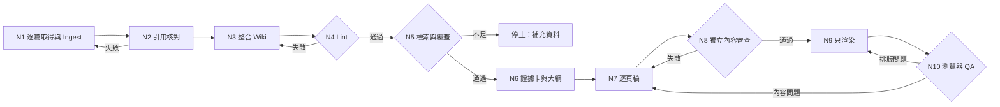

# Graph：EEG 到 E/I 教學

| 節點 | 輸入 → 輸出 | 責任及通過條件 | 失敗回退 | 實作狀態 |
|---|---|---|---|---|
| N1 | 全文 → 紙本筆記 | 執行者讀全文、列資料方法限制 | 該篇來源 | 手動，未完成 |
| N2 | 原文及筆記 → 定位引用 | 執行者逐項核對，無無法支持主張 | N1 | 手動，未完成 |
| N3 | 經核對筆記 → 概念與比較 | 執行者保留差異 | N1/N2 | 草稿 |
| N4 | Wiki、metadata → 檢查結果 | Python 檢查連結、ID、五篇通過 | N3 或 N1 | 可執行 |
| N5 | Wiki → 檢索與覆蓋 | 針對五問題檢索；資料不足停止 | N3 | 查詢可執行；覆蓋檢查未完成 |
| N6 | 檢索內容 → 證據卡及大綱 | 每頁都有可定位來源 | N5 | 未完成 |
| N7 | 證據卡 → 逐頁稿 | 不引入卡片外知識 | N6 | 未完成 |
| N8 | 逐頁稿及來源 → 審查 | 獨立回合逐項核對；有錯則不通過 | N7/N6 | 未執行 |
| N9 | 審查通過逐頁稿 → HTML | 僅排版，不改科學文字 | N7 | 未完成 |
| N10 | HTML → QA 報告與網站 | 真實瀏覽器、互動、溢出檢查 | N9 或 N7 | 未執行 |

每個局部修正最多三輪；三輪仍不通過或核心資料不足即停止並保留 FAIL。`python3 scripts/graph.py` 實際執行 N4 並依結果選擇下一狀態；它不是自動執行全部節點或自動修復。人負責其他尚未自動化的節點。
