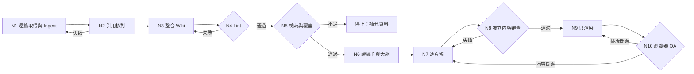

# Graph：EEG 到 E/I 教學

| 節點 | 輸入 → 輸出 | 責任及通過條件 | 失敗回退 | 實作狀態 |
|---|---|---|---|---|
| N1 | 全文 → paper notes | 執行者讀取主要方法、結果與限制 | 該篇來源 | 六篇聚焦閱讀完成；非逐字審讀，見 `reports/ingest-checks.md` |
| N2 | 原文及筆記 → 定位引用 | 執行者對照引用 | N1 | 六篇人工對照完成；程式定位詞檢查不等於語意審查 |
| N3 | 筆記 → 概念與比較 | 保留研究差異 | N1/N2 | 九個概念頁與比較頁已建立 |
| N4 | Wiki、metadata → lint | Python 檢查連結、ID、來源數 | N3 或 N1 | 已執行並通過；未自動核實科學內容 |
| N5 | Wiki → 檢索與覆蓋 | 五題查詢，資料不足停止 | N3 | 五題查詢已實跑；完整覆蓋率人工評估未完成 |
| N6 | 檢索內容 → evidence map 與大綱 | 每頁有來源定位 | N5 | 15 頁 map 與大綱已建立並通過結構檢查 |
| N7 | 證據卡 → 逐頁稿 | 只用 Wiki 已有知識 | N6 | 15 頁逐頁稿已建立；新增內容先更新 Wiki |
| N8 | 逐頁稿及來源 → 獨立審查 | 與製作者獨立的審查回合逐項核對 | N7/N6 | **未完成；不可標示 PASS**。既有核對由製作者執行 |
| N9 | 逐頁稿 → HTML | 排版、互動及產物檢查，不擅改科學文字 | N7 | 已產生；目前先於 N8 完成，屬流程未閉合；N9 圖表檢查另行執行 |
| N10 | HTML → QA 與網站 | 實際瀏覽器檢查、部署 | N9 或 N7 | 桌面、手機與公開頁已測試；範圍與結果見 `reports/final-report.md` |

每個局部修正最多三輪；三輪仍不通過或核心資料不足即停止並保留 FAIL。`python3 scripts/graph.py` 實際執行 N4 與 N6/N9 結構檢查並依結果選擇下一狀態；它不是自動執行全部節點或自動修復。人負責其他尚未自動化的節點。

## 實作更新（2026-11-23）

`python3 scripts/graph.py --attempt 1` 依序執行現有 N4 Wiki lint 與 N6/N9 證據地圖／HTML 結構關卡；失敗時輸出指定回退節點，三次為上限。修正由操作人執行，重新執行時以 `--attempt 2` 或 `--attempt 3` 記錄；這不是自動修復。其他節點仍是人工工作。N8 的獨立科學審查尚未完成；目前僅有製作者對照來源的審查紀錄，見 `reports/content-review.md`。瀏覽器測試是另外執行的 N10。

## 將圖表檢查前移

`tests/render_plot.cjs` 在 N9 渲染後、完整 N10 瀏覽器 QA 前，實際調整 β 並讀取固定座標的畫布像素，確認起點近似固定且較大 β 的末端下降。此項需要 Chrome／Playwright；它是單獨執行的 N9 關卡，尚未納入 `graph.py` 的自動調度。

## 2026-11-23 教學改版

先補充 `wiki/concepts/teaching-foundations.md`，再更新 15 頁逐頁稿與 evidence map，最後以 `scripts/render.py` 渲染。Teaching Quality Review 由製作者執行並保留逐頁理由；這不代表 N8 的獨立科學審查已完成。新增合成圖表的數值測試及桌機／手機互動測試；記錄位於 `reports/teaching-redesign-20261123/`。
