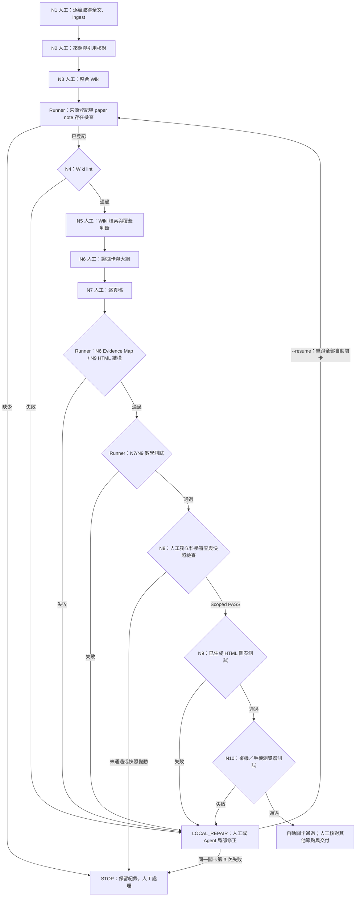

# Graph：EEG 到 E/I 教學（2026-11-23 現況）

N8 的驗收是 15 頁重要科學主張的獨立來源忠實度審查；不以六篇逐字審讀為必要條件，也不聲稱已逐字審讀。獨立報告逐頁及 S05 後續結果均為 **SCOPED PASS**，限制見 [獨立審查](../reports/n8-independent-final.md)。原始 ingest 的全文取得和聚焦閱讀、逐篇紀錄仍是獨立要求。若審查過的輸入改變，runner 停下要求重新審查；雜湊只檢查快照一致，不能證明科學正確。



上圖同時顯示人工工作及 runner 的順序；runner 不執行 N1–N3、N5–N8 的內容製作或科學審查，也不自行呼叫 Codex 修復。N6/N9 結構檢查、N7/N9 數學測試在 N8 快照前執行；HTML 已於歷史流程先生成，本輪只檢查既有產物，不重渲染或部署。

| 節點 | 實際責任與現況 |
|---|---|
| N1 | 人工逐篇取得與 ingest；六篇先前聚焦閱讀完成，非逐字審讀。runner 只核對六筆登記與 paper note 存在，無法證明目前網路可用或全文已閱讀。 |
| N2 | 人工定位引用和檢核來源；科學判斷不由程式完成。 |
| N3 | 人工整合 Wiki 與研究差異。 |
| N4 | runner 自動 `scripts/check.py`；檢查 ID、DOI 格式、相對連結等，非書目或語意驗證。 |
| N5 | 查詢工具可由人執行；五題已有紀錄，**完整覆蓋率人工評估仍未完成**，runner 不執行、不假定通過。 |
| N6 | 人工提供證據卡及定位；runner 用 `scripts/check_deck.py` 驗欄位、來源／Wiki 存在與 HTML 對應，不能判斷引文忠實。 |
| N7 | 人工提供逐頁稿；runner 執行 `tests/teaching_math.cjs` 驗合成例及數值實作。 |
| N8 | 獨立審查 **SCOPED PASS**，見報告；runner 只檢驗 [決議快照](../reports/n8-scoped-decision.json) 與來源登記、HTML、map、概念頁及審查報告的雜湊，不產生科學判斷。 |
| N9 | 人工／Agent 遵照已審稿製作 HTML；runner 檢查結構，並執行 `tests/render_plot.cjs` 測固定座標的 exponent 畫布。 |
| N10 | runner 執行 `tests/browser.cjs` 測本機 HTML 的桌機／手機及互動；公開部署、上線版本、其他瀏覽器與真實使用者評估不是本次 runner 執行範圍。 |

## 執行與半自動回退

需 Python 3、Node.js、可被 Node 找到的 Playwright，以及測試檔指定的 macOS Chrome。依本機安裝狀況設定 `NODE_PATH`；例如本次使用 bundled Node modules。從 repository 根目錄執行：

```sh
NODE_PATH=/path/to/node_modules python3 scripts/graph.py
python3 scripts/graph.py --resume reports/workflow-runs/<run-id>/state.json
python3 -m unittest discover -s tests -p 'test_graph.py'
```

每次 run 保存獨立 `state.json`、各關卡輸出與 N10 截圖於 `reports/workflow-runs/<run-id>/`，不覆寫歷史 `reports/graph-state.json`。狀態記錄節點、結果、失敗原因及輸出檔、回退目標、嘗試次數和停止條件。非零結果為真實 FAIL；人或 Agent 依輸出判斷是環境或內容問題並修復，再以 `--resume` 延續；同一關卡第 3 次失敗 STOP。來源登記／paper note 缺失、N8 審查快照不符、執行程式不存在或逾時為 BLOCKED 並 STOP，需人工處理；runner 不會以等待或自動重試當作修復。停止後，確認問題與授權後才啟動新的工作流程；不可用新 run 隱藏舊失敗。隔離單元測試內的模擬錯誤只在臨時目錄，不是實際流程錯誤。

最新完整實際 run：[`20261123T150115Z-47042dda/state.json`](../reports/workflow-runs/20261123T150115Z-47042dda/state.json)，自動關卡均通過；本次首次 Chrome 在沙箱啟動失敗及後續沙箱外重跑分別保存在 [`20261123T145942Z-f0a52a20`](../reports/workflow-runs/20261123T145942Z-f0a52a20/state.json) 與 [`20261123T145956Z-be3249b2`](../reports/workflow-runs/20261123T145956Z-be3249b2/state.json)。歷史來源重查、局部回退及舊失敗見 [N8 製作者紀錄](../reports/n8-independent-review.md) 與 [執行報告](../reports/final-report.md)，不可把過去 PENDING 讀作當前 N8 狀態。
